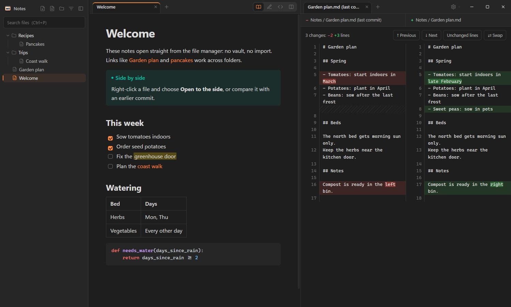

# MRAkdown

A lightweight Markdown viewer and editor for Windows and Linux. Double-click a `.md` file and it opens, with the folder
around it in a sidebar: there's no vault to set up. It reads notes written for Obsidian, with their `[[wikilinks]]` and
callouts.



MRAkdown is a personal project, shared as-is: there's no promise of support, fixes or new features. It runs on
Windows 10 and 11, and on Linux with recent GTK libraries (see [Linux](#linux)).

## Features

- **Reading view:** `[[wikilinks]]` (also to headings and with aliases) and callouts as in Obsidian, plus
  highlights, task lists, tables, footnotes, embedded images and syntax-highlighted code
- **Folder sidebar** with search by file name and path. Opening a file shows its nearest `.obsidian` or `.git`
  folder, or else its own folder. Choose whether the sidebar lists Markdown files only, also files with a viewer of
  their own, or all files; hidden files and folders and `node_modules` are left out.
- **Read, Edit and Split** (live preview) modes, with a formatting toolbar. Pasted or dropped images are saved in an
  `attachments` folder next to the file.
- **Saving when you choose:** a tab keeps its unsaved edits (marked with a dot) until you save them with `Ctrl+S`,
  also while you look at other tabs. You're asked Save / Don't save / Cancel before they'd be lost: closing the tab or
  window, or opening another file in it. Turn on "Save automatically" in Settings to have edits saved whenever you
  switch to another file, tab or mode instead. A new file asks where to save it the first time. If a file was changed
  on disk since you opened it, you're asked before your version overwrites it.
- **Follows changes from other programs:** when a file you have open changes on disk (another editor, `git pull`),
  it shows the new version, unless you have unsaved edits in it; the folder list updates too.
- **Tabs** with their own back/forward history; drag tabs to reorder them, into a new window, or onto another window
- **Two panes side by side**, each with its own tabs and mode: "Open to the side" from a file, link or tab menu, or
  drag a tab onto the right half of the page
- **Compare files** side by side, with changed lines and words highlighted and unchanged stretches folded: two files,
  or a file with its last git commit or any earlier commit
- **Other files open too:** JSON, CSV/TSV and XML in viewers of their own; `.txt`, `.log` and files without an extension
  as plain text; other text files as code ("View as" picks another viewer, remembered per file type)
- **Keeps each file's encoding** (UTF-8, UTF-16, Windows-1252) and line endings (CRLF or LF) when saving. A
  Windows-1252 file that gets characters it can't hold, such as emoji, is saved as UTF-8 instead.
- **One running instance:** opening more files adds tabs to the window you used last
- **Settings** (the gear button): accent colour, automatic saving, and keyboard shortcuts
- Follows the system's light or dark theme

MRAkdown has no account and no telemetry of its own; your files are only read and written on your own computer. Web
links open in your browser, and images that a note embeds from the web load as they would in a browser. (On Windows,
the WebView2 runtime that shows the page follows Microsoft's own settings for diagnostic data.)

## Install

Comparing with git commits needs [git](https://git-scm.com/), on the `PATH`.

### Windows

Download `MRAkdown-…-win-x64.zip` from the [latest release](https://github.com/MtnGoatDK/MRAkdown/releases/latest),
unzip it somewhere permanent and run `MRAkdown.exe`. It needs the
[.NET 10 Desktop Runtime](https://dotnet.microsoft.com/download/dotnet/10.0) and the WebView2 Runtime (built into
Windows 11; on Windows 10, install it from Microsoft if it's missing). The `.exe` isn't code-signed, so Windows may warn
the first time you run it: choose "More info", then "Run anyway" (or right-click the zip, choose Properties and tick
"Unblock" before unzipping). To open Markdown files with it by double-clicking, choose it under "Open with" in Explorer.

To build it yourself instead, you need the [.NET 10 SDK](https://dotnet.microsoft.com/download):

```powershell
dotnet publish src\MRAkdown.Windows -c Release -o publish
```

This builds `publish\MRAkdown.exe`.

There is no separate title bar: the tab bar takes its place. Drag its empty part (or the folder name above the
sidebar) to move the window; double-click it to maximize, right-click it for the window menu. Snapping and resizing
from every edge work as usual. Hovering the maximize button doesn't show the Snap Layouts menu; `Win+Z` does.

The release download is a single small `.exe`, built by `.github/workflows/release.yml` when a version tag such as
`v1.0.0` is pushed. The same build locally (without ReadyToRun, which crashes combined with single-file on installed
.NET):

```powershell
dotnet publish src\MRAkdown.Windows -c Release -r win-x64 --self-contained false -p:PublishSingleFile=true -p:IncludeNativeLibrariesForSelfExtract=true -p:PublishReadyToRun=false -p:DebugType=none -o share
```

### Linux

Needs at least GTK 4.10, libadwaita 1.5 and WebKitGTK 2.40 (its 6.0 API): MRAkdown uses functions those versions
added, so older releases of some distributions are too old. Tested with GTK 4.24, libadwaita 1.10 and WebKitGTK 2.54.
On Arch and CachyOS: `sudo pacman -S dotnet-sdk gtk4 libadwaita webkitgtk-6.0`. It builds for the processor of the
machine it's built on (x86-64 or ARM64).

```sh
packaging/linux/install.sh             # build and install for the current user (in ~/.local)
packaging/linux/install.sh --default   # ...and make it the default app for Markdown files
packaging/linux/install.sh --uninstall # keeps your settings
```

MRAkdown is then in the app menu, and `mrakdown [file or folder]` starts it from a terminal (if `~/.local/bin` is on
your `PATH`). To update, close MRAkdown and run the install script again.

Differences from Windows:

- As on Windows, there is no separate title bar: drag the empty part of the top bar to move the window. Double, middle
  and right clicks there do what your desktop does for title bars, and the window buttons follow the desktop's button
  layout.
- Wayland doesn't tell apps where windows are, so dropping a tab onto another window relies on that window noticing
  the pointer entering it, and new windows open where the desktop puts them.
- If pages render blank or with glitches on NVIDIA graphics, try starting it with `WEBKIT_DISABLE_DMABUF_RENDERER=1`.

## Using it

### Panes and comparisons

- **Open to the side:** right-click a file in the sidebar, a link or a tab, or drag a tab onto the right half of the
  page (when its pane has other tabs). Drag a tab onto the other pane to move it there; a pane closes with its last
  tab, and the divider between the panes can be dragged (double-click it to reset).
- **Compare two files:** right-click one and choose "Select for compare", then right-click the other and choose
  "Compare with …". A file's menu in the sidebar can also compare it with the file open now, and with two panes open,
  a tab's menu with the file in the other pane.
- **Compare with git:** "Compare with last commit", or "Compare with commit…" to pick from the commits that changed the
  file (renames are followed).
- Comparisons use the files as saved, and ignore differences in line endings alone.

A very large folder (over 50,000 files and folders, such as a home folder) is scanned as you open its subfolders, so
links and search then cover the folders opened so far. Links to folders (symlinks, junctions) aren't followed.

### Keyboard shortcuts

These are the defaults. All keys except `Ctrl+1…9` can be changed in Settings, under "Change shortcuts…" (the mouse
buttons can't).

| Keys | Action |
|---|---|
| `Ctrl+N` / `Ctrl+Shift+N` | New file / new window |
| `Ctrl+O` / `Ctrl+Shift+O` | Open file / open folder |
| `Ctrl+S` | Save (asks where, for a new file) |
| `Ctrl+E` / `Ctrl+Shift+E` | Toggle Edit / Split mode |
| `Ctrl+P` | Search files (`Enter` opens the first match, `Esc` clears) |
| `Ctrl+T` (or the + after the tabs), `Ctrl+W`, `Ctrl+Shift+T` | New, close, reopen tab |
| `Ctrl+Tab`, `Ctrl+Shift+Tab`, `Ctrl+PageDown`, `Ctrl+PageUp` | Next / previous tab |
| `Ctrl+1…8`, `Ctrl+9` | Go to that tab, to the last tab |
| `Alt+←` / `Alt+→`, mouse back / forward | Back / forward |
| `F5` or `Ctrl+R` | Reload the file and folder |
| `F7` / `Shift+F7` | Next / previous change, in a comparison |
| `Ctrl+\` | Show or hide the folder panel |
| `Ctrl+Shift+W` | Close the window |
| `Ctrl+B` / `Ctrl+I` / `Ctrl+K` | Bold / italic / link, while editing a Markdown file |

Clicking a file or link opens it in the current tab. `Ctrl+click` or middle-click opens it in a background tab,
`Ctrl+Shift+click` in a new tab you switch to, and `Shift+click` in a new window. Middle-click a tab to close it.

## Development

The UI is a web page (`web/`) shown by a small native host: WinForms with WebView2 on Windows, and GTK 4 with
libadwaita and WebKitGTK (through [Gir.Core](https://gircore.github.io/)) on Linux. Both are built with .NET 10.

| Folder | What |
|---|---|
| `src/MRAkdown.Core` | Shared: indexing folders, rendering Markdown, wikilinks, file encodings, git history, and serving the page (`NoteServer`) |
| `src/MRAkdown.Windows` | Windows host: a WinForms window with WebView2 |
| `src/MRAkdown.Linux` | Linux host: a libadwaita window with WebKitGTK; the page is served under `mrakdown://notes/` |
| `web/` | The page, shared by both hosts (embedded in Core) |
| `packaging/linux` | Desktop entry and per-user install script |
| `assets/` | Windows app icon (made from `web/logo.svg` by `make-icon.ps1`, on Windows with Microsoft Edge) and the screenshot |

- Run the Linux version from the repo with `dotnet run --project src/MRAkdown.Linux -- [file or folder]`.
- `MRAKDOWN_DEVTOOLS=1` (Linux) enables Inspect Element in the page and prints its console messages.
- `MRAKDOWN_INSTANCE=name` starts a separate instance, e.g. to test next to an installed copy that is in use.

## License

MRAkdown is free software under the [GNU General Public License v3.0](LICENSE).

It uses [Markdig](https://github.com/xoofx/markdig) (BSD-2-Clause), [Gir.Core](https://gircore.github.io/) (MIT) and
the WebView2 SDK (BSD-3-Clause style, Microsoft), and includes [highlight.js](https://highlightjs.org/) 11.9.0
(BSD-3-Clause) in `web/hljs*`.

MRAkdown isn't affiliated with or endorsed by Obsidian.
